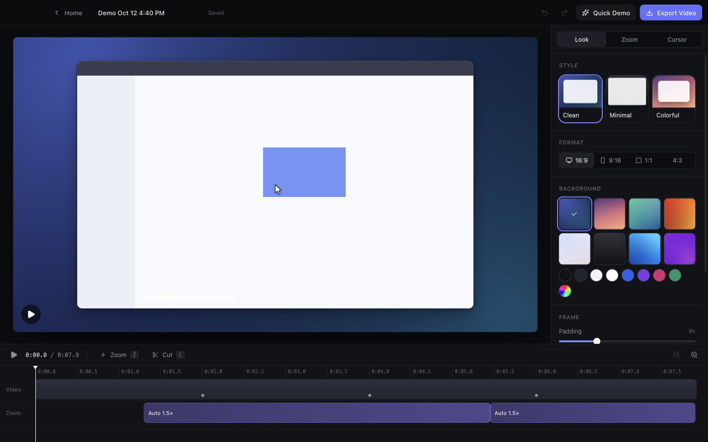

# FrameFlow

**Record your screen. Get a beautiful demo video automatically.**

FrameFlow is a macOS desktop app for making polished software demos. It records your screen
without the system cursor, tracks your cursor and clicks, and turns the recording into a
finished video: smooth cursor movement, zooms toward the things you interact with, and a
styled backdrop with padding, rounded corners and a soft shadow. Export it as an H.264 MP4.


## Two ways to work, one project

- **Quick Demo** (default). Record, stop, and FrameFlow does the editing: automatic zooms
  from your clicks and pauses, a smoothed cursor, and a professional style. Choose a style
  (Clean, Minimal, Colorful), a zoom intensity (Off, Subtle, Dynamic), a background and a
  format (16:9, 9:16, 1:1), then export.
- **Advanced Editor**. Full control over the same project: a timeline with the automatic
  zooms as editable blocks, manual zooms (level, focus point or follow-cursor, timing,
  easing), cuts, background, padding, corners, shadow, scale, cursor size, smoothing and
  click effects, export settings, and undo/redo.

Switching from Quick Demo to the Advanced Editor keeps everything: the original recording,
the automatic zooms (now visible on the timeline), style and format. Both views edit the
same project and use the same renderer and exporter.



## Features

- Record a whole display or a single window (macOS ScreenCaptureKit), with an optional
  countdown, optional microphone and a floating stop control that isn't recorded.
- The system cursor stays out of the recording. Cursor position and clicks are recorded at
  60 Hz on the video's clock, then drawn as a smooth vector cursor with click ripples.
- Automatic zoom from cursor data: clusters clicks and pauses, chains nearby zooms into pans,
  caps how often zooms happen, and keeps every zoom inside the frame.
- Manual zooms work on any video, including imported files without cursor data.
- Trimming: cut any number of sections out. Zooms and cursor stay attached to the footage.
- Backgrounds: 8 gradient presets, solid colors and a custom color picker. Adjustable
  padding, corner radius, shadow and scale. Output formats 16:9, 9:16, 1:1 and 4:3.
- Export: H.264 MP4 at 720p, 1080p, 1440p or 4K, 30 or 60 fps, with AAC audio when the source
  has it. Shows progress, can be cancelled, streams to disk and never leaves a partial file.
- Projects: autosaved `.frameflow` files, a Recent Projects list, Open Project…, and
  relinking when the source video was moved.
- Private by design: no accounts, no analytics, no network. Everything stays on your Mac.

## Requirements

- macOS 14 or later on Apple silicon (the tested configuration). The capture helper is built universal, but the packaged app targets arm64 only; Intel is untested.
- Screen Recording permission (System Settings › Privacy & Security › Screen & System Audio
  Recording). FrameFlow shows guidance if it is missing.
- Microphone recording needs macOS 15 and Microphone permission.
- For development: Node.js 22, npm 10 and Xcode Command Line Tools (Swift 5.9+).

## Install and run (development)

```bash
npm install
```

```bash
npm run dev
```

`npm run dev` compiles the native capture helper (`resources/bin/FrameFlowCapture`) the
first time, then starts Electron with hot reload. If you launch from a terminal, macOS
attributes the Screen Recording permission to that terminal app.

## Build

```bash
npm run package
```

This builds `release/mac-arm64/FrameFlow.app`. To also produce a DMG:

```bash
npm run dist
```

The resulting DMG is `release/FrameFlow-0.1.0-arm64.dmg`. Builds are ad-hoc signed. To
distribute, sign with a Developer ID (`CSC_NAME`), enable the hardened runtime, notarize,
and set the `enableNodeCliInspectArguments` fuse to `false` in `electron-builder.yml`.

## Test

```bash
npm run fixtures
```

```bash
npm test
```

```bash
npm run test:e2e
```

`npm run fixtures` generates the synthetic test videos. `npm test` runs the unit tests, and
`npm run test:e2e` runs the end-to-end tests: it builds the app, drives it with Playwright
and inspects the exported files with ffprobe and ffmpeg. See [docs/testing.md](docs/testing.md),
and see [docs/verification.md](docs/verification.md) for the results of the latest run.

Other checks: `npm run typecheck` and `npm run lint`.

## Project layout

```
native/macos/        Swift ScreenCaptureKit capture helper
src/main/            Electron main: windows, IPC, capture control, files, projects
src/preload/         The typed, minimal API exposed to the renderer
src/shared/          Pure TypeScript: project model, styles, engine (timeline, cursor, camera, auto zoom, layout)
src/renderer/        React UI, shared frame renderer, export pipeline
tests/unit/          Vitest unit tests
tests/e2e/           Playwright Electron tests
scripts/             Native build, fixture generation, icon rendering
docs/                Architecture, testing, roadmap, verification
```

## Known limitations

- **macOS only.** Capture uses ScreenCaptureKit; there is no Windows or Linux recorder yet.
- **Microphone** capture is implemented but was not verified on the development machine,
  because it requires a microphone permission prompt. System audio and webcam are not
  supported yet.
- **Cursor appearance** is a single arrow; the real cursor shape (I-beam, hand) is not captured.
- **Window recording** follows the window's frame for cursor mapping. Resizing a window
  while recording is not handled specially.
- **Imported videos** keep their own cursor in the pixels, so automatic zoom and cursor
  styling are unavailable for them; manual zoom works.
- Builds are not notarized.

See [docs/roadmap.md](docs/roadmap.md).

## Credits

FrameFlow's feature set was inspired by [OpenScreen](https://github.com/siddharthvaddem/openscreen)
(MIT). FrameFlow is an independent implementation; see [docs/architecture.md](docs/architecture.md)
and [THIRD-PARTY-NOTICES.md](THIRD-PARTY-NOTICES.md).

## License

MIT
