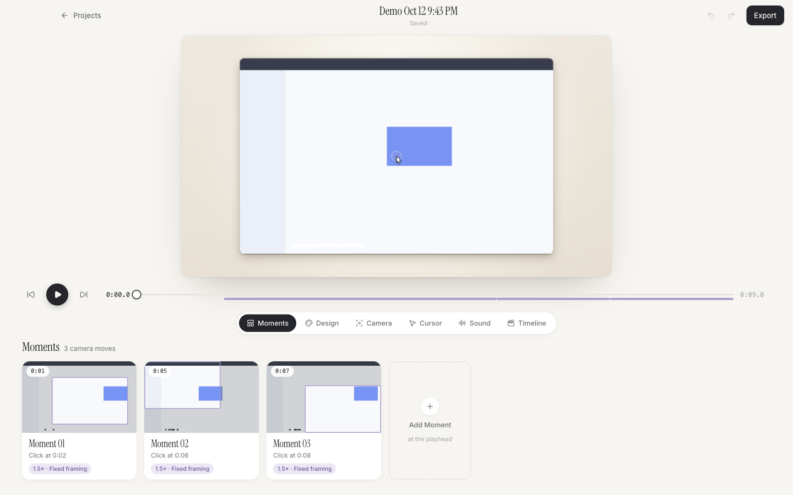
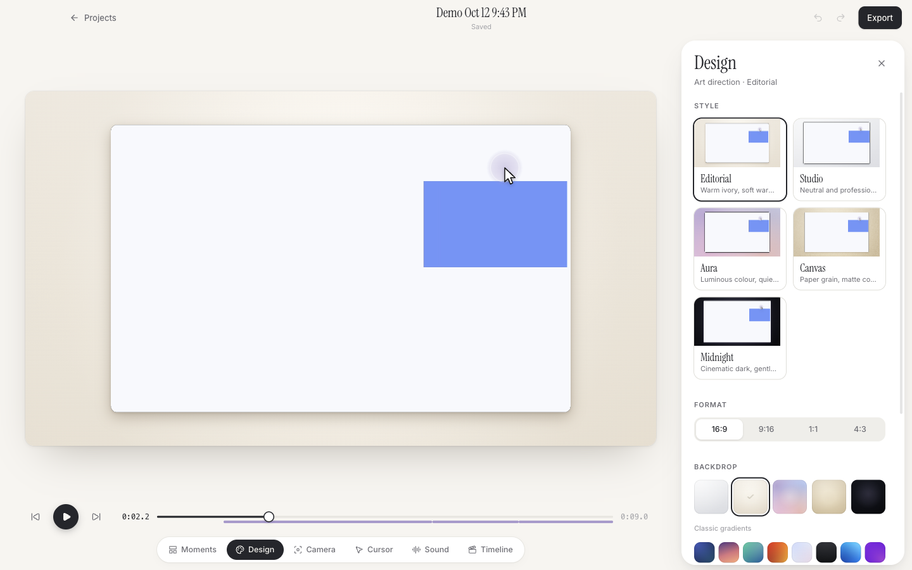
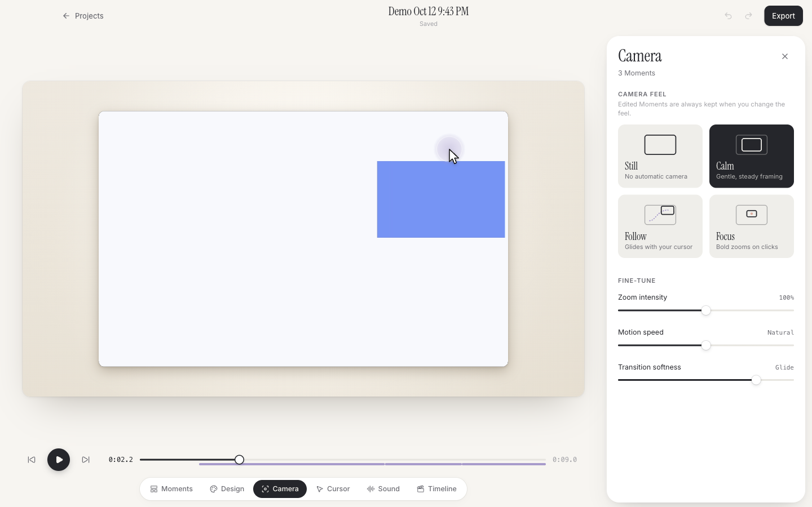
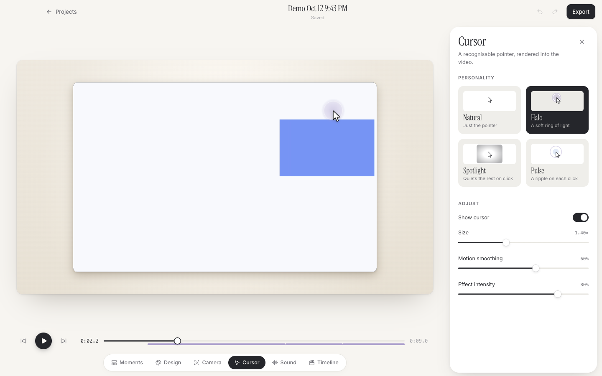
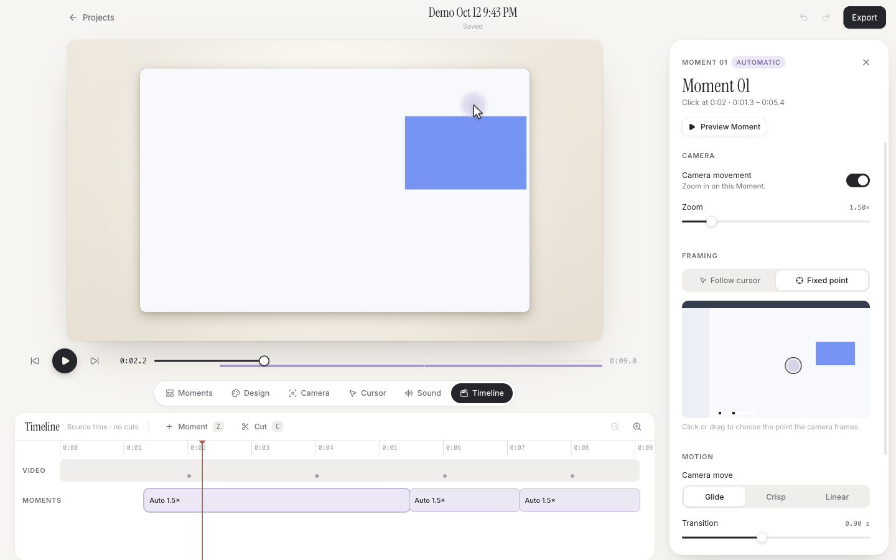
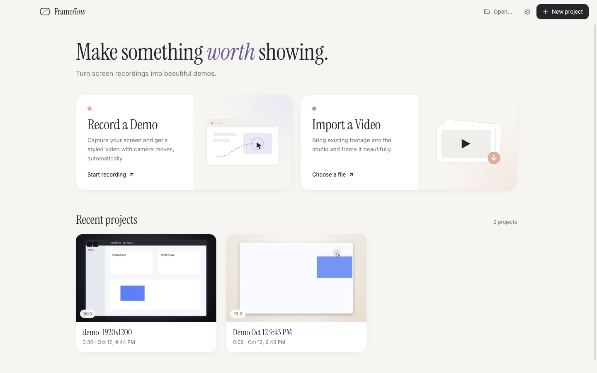
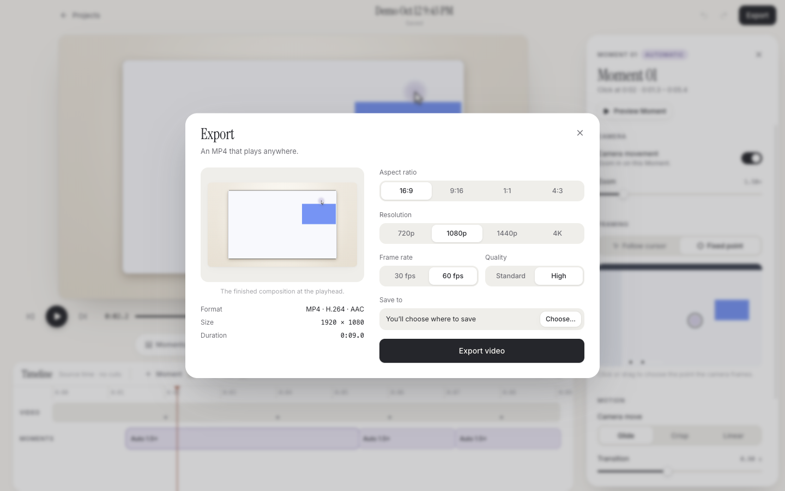
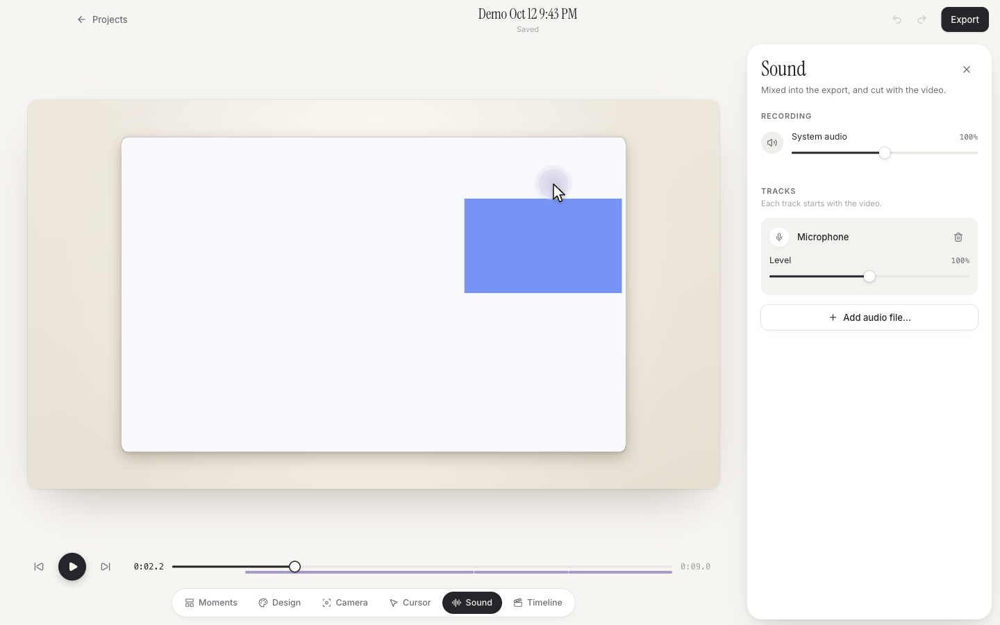
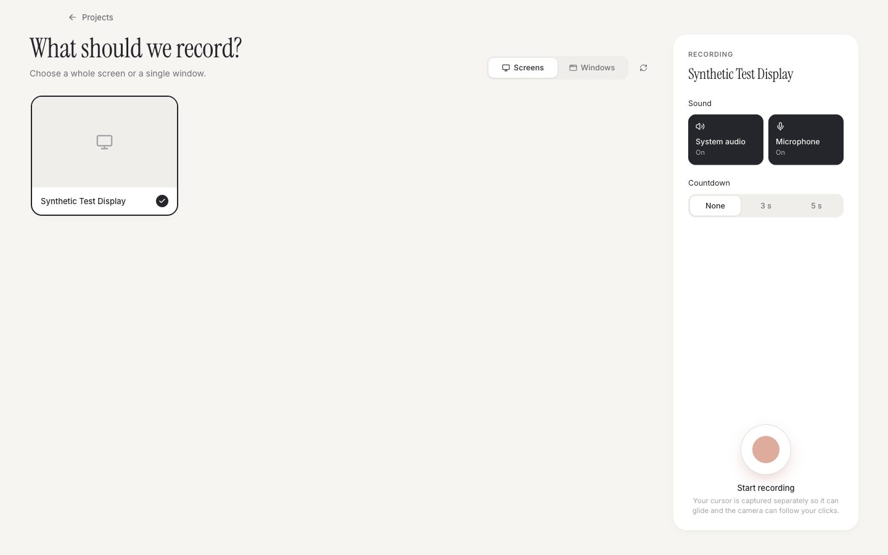

# FrameFlow

**Make something worth showing.** FrameFlow is a calm, editorial studio for turning screen
recordings into beautiful product demos. It runs on macOS.



You record your screen and stop. FrameFlow opens the result in the Studio, already polished:

- the camera eases toward the moments you interacted with,
- the cursor glides,
- the composition sits on a carefully art-directed backdrop.

From there you can choose a different style, camera feel or cursor, and export an MP4. You
never need to touch a timeline unless you want to.

## What's in 2.0

FrameFlow 2.0 redesigns the whole experience around the existing recording, rendering and
export engine. See [docs/redesign.md](docs/redesign.md).

- **A project gallery.** Home is a gallery of your projects, each with a real thumbnail and
  its duration and format. You can rename a project, show it in Finder, remove it from Recents
  (its files are kept), and see when its video is missing.
- **A canvas-first Studio.** The styled composition fills the screen. A dock switches
  between Moments, Design, Camera, Cursor and Timeline. All of them edit the same project, and
  the preview never reloads.
- **Moments.** Each camera move appears as a card showing a real frame from the video, an
  honest label ("Click at 0:08") and its framing. You can:
  - select a Moment to jump to it, preview it, or rename it;
  - change its zoom, focus point, motion, transition or timing;
  - turn its camera movement off, delete it, or add a new one.
- **Five art directions.**
  - **Editorial**: warm ivory. This is the signature style.
  - **Studio**: neutral.
  - **Aura**: luminous colour.
  - **Canvas**: paper with deterministic grain.
  - **Midnight**: cinematic dark.

  Each one is previewed live with your own footage, and everything stays adjustable afterwards.
- **Camera Feel.** Choose **Still**, **Calm**, **Follow** (with a steadiness dead zone) or
  **Focus**, then fine-tune intensity, speed, softness and following. Moments you have edited
  always survive a feel change.
- **Cursor personality.** Choose **Natural**, **Halo**, **Spotlight** or **Pulse**. Each is
  rendered into the exported video and stays aligned through zooms and cuts.
- **Sound (2.1).** Record **system audio** (what your Mac plays) and/or the
  **microphone**. Add imported audio files such as a voice-over or music, and set levels from
  0–200%. Everything is mixed into one AAC track in the export, follows your cuts, and plays
  in sync in the preview.
- **Timeline.** The precision timeline is still there for cuts and exact timing. Moments and
  the timeline are the same data.
- **Export sheet.** It shows a live preview of the final composition and lets you set aspect
  ratio, resolution (720p–4K), frame rate, quality and destination. Progress is real, it can
  be cancelled, and it never leaves a partial file behind.
- **Your old projects still work.** 0.1 projects open unchanged, and their exports are
  pixel-identical to 0.1. The first time one is saved, a `.v1.bak` copy is kept.

| | |
|---|---|
|  |  |
|  |  |
|  |  |
|  |  |

The 0.1 interface is preserved in [docs/redesign/before](docs/redesign/before) for
comparison; see [docs/redesign/comparison.md](docs/redesign/comparison.md).

## Still true from 0.1

- Native recording with ScreenCaptureKit, of a whole display or a single window. The system
  cursor is kept out of the pixels. Cursor and clicks are sampled at 60 Hz on the video's
  clock.
- An optional countdown, and a floating stop control that is never recorded.
- Optional system audio (verified with real capture) and microphone recording. The
  microphone is implemented but not yet verified on real hardware; see Known limitations.
- One shared Canvas renderer draws both the preview and the export.
- Export uses WebCodecs H.264 with AAC audio. It is streamed to disk and renamed into place
  only when complete.
- Projects are autosaved `.frameflow` files. They are validated on load and save, and if the
  media is missing you can relink it.
- Local-first and private: no accounts, no analytics, no network.

## Requirements

- macOS 14 or later on Apple silicon. This is the tested configuration.
- The Screen Recording permission. FrameFlow guides you if it is missing.
- For development: Node.js 22, npm 10 and the Xcode Command Line Tools (Swift).

## Run

Install dependencies:

```bash
npm install
```

Start the app in development mode:

```bash
npm run dev
```

## Build

Build `release/mac-arm64/FrameFlow.app`:

```bash
npm run package
```

Also produce `release/FrameFlow-2.1.0-arm64.dmg`:

```bash
npm run dist
```

Builds are ad-hoc signed. For public distribution you need to:

- sign with a Developer ID,
- enable the hardened runtime,
- notarize,
- set the `enableNodeCliInspectArguments` fuse to `false`.

## Test

Generate the test fixtures first:

```bash
npm run fixtures
```

Run the unit tests:

```bash
npm test
```

Run the end-to-end tests:

```bash
npm run test:e2e
```

[docs/testing.md](docs/testing.md) covers what is tested and how exports are verified.
[docs/verification.md](docs/verification.md) has the latest real results.

## Project layout

```
native/macos/          Swift ScreenCaptureKit capture helper
src/main/              Electron main: windows, IPC, capture, files, projects
src/preload/           Typed, minimal renderer API
src/shared/            Project model + migration, styles, Moments, engine (timeline, cursor, camera, auto zoom, layout)
src/renderer/src/      React UI (screens, studio panels), shared frame renderer, exporter
tests/unit             Vitest
tests/e2e              Playwright Electron (incl. legacy golden-frame comparison)
tests/fixtures/legacy  Real 0.1 project files and golden frames exported by 0.1
docs/                  Architecture, redesign, testing, roadmap, verification
```

## Known limitations

- **macOS only.** There is no Windows or Linux capture back-end yet.
- **Microphone narration is not verified.** The code exists, but testing it requires a
  macOS permission prompt.
- **No webcam yet.** Picture-in-picture needs the camera permission and is next on the
  roadmap.
- **The cursor is always drawn as an arrow.** Real cursor shapes are not captured.
- **Imported videos have the cursor baked into their pixels.** Cursor treatments and the
  automatic camera are unavailable for them. Manual Moments work.
- **Builds are not notarized.**

## License

MIT. See [THIRD-PARTY-NOTICES.md](THIRD-PARTY-NOTICES.md).
