# Before and after: FrameFlow 0.1 → 2.0

The images on the left are from `before/` and were captured before any 2.0 change. The images
on the right are from `../media/` and come from the 2.0 build. Both sets were made by the same
automated screenshot spec, using the same synthetic recording.

| | 0.1 | 2.0 |
|---|---|---|
| Home (empty) | 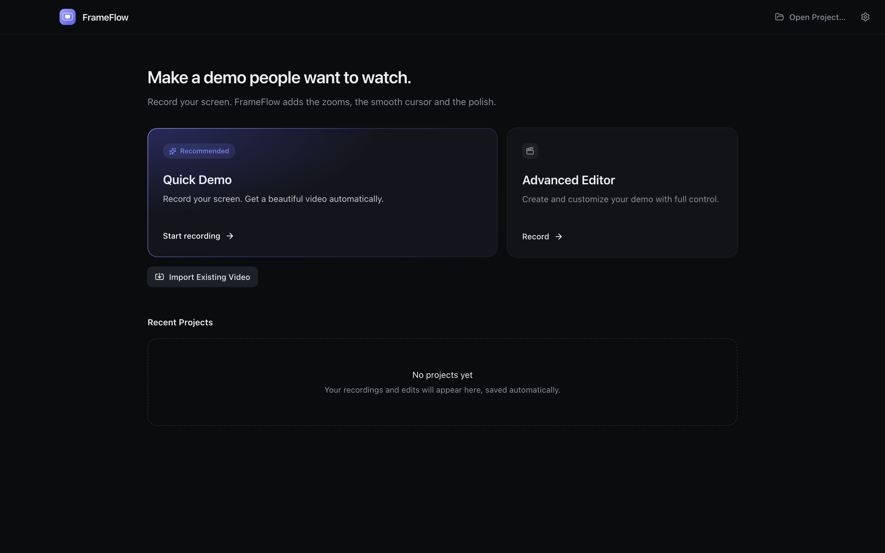 | 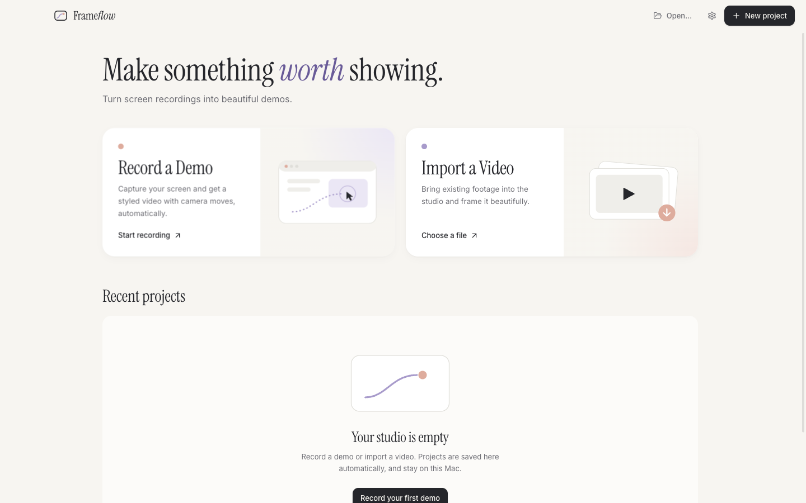 |
| Home (projects) | 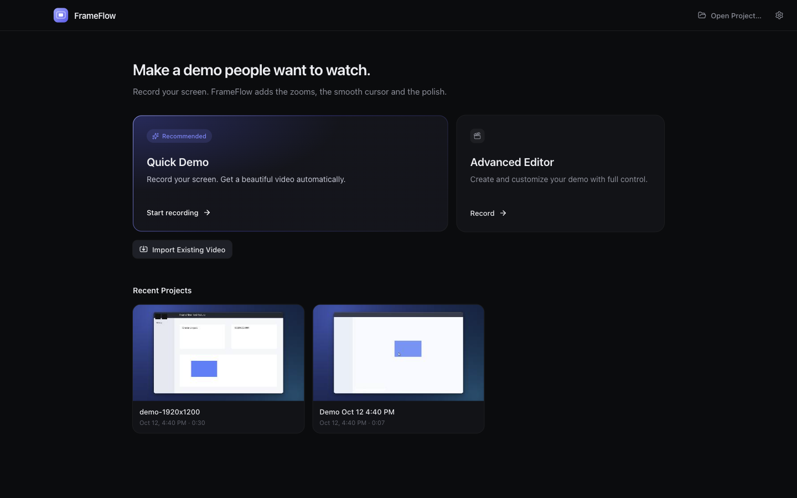 |  |
| Record setup | 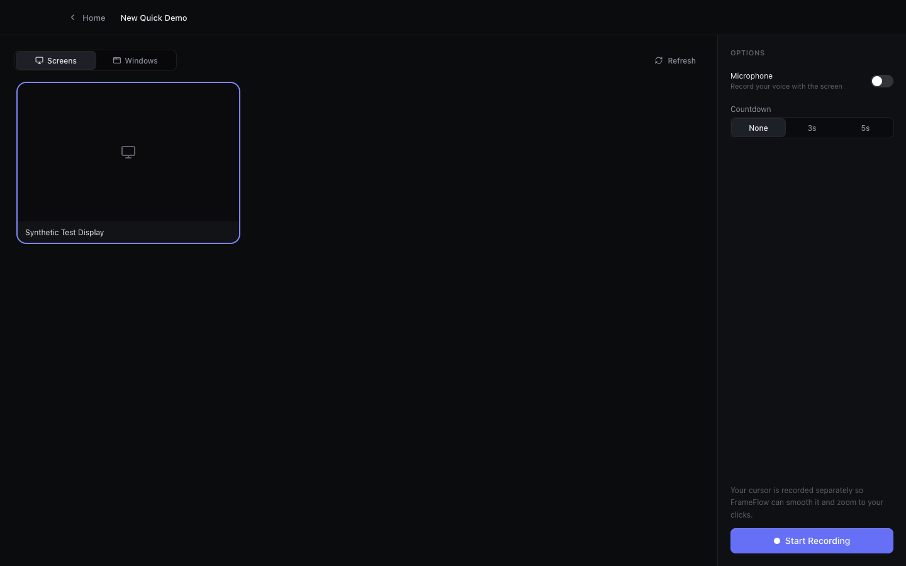 |  |
| Recording HUD | 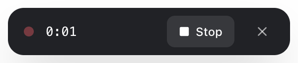 | 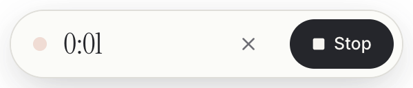 |
| After recording | 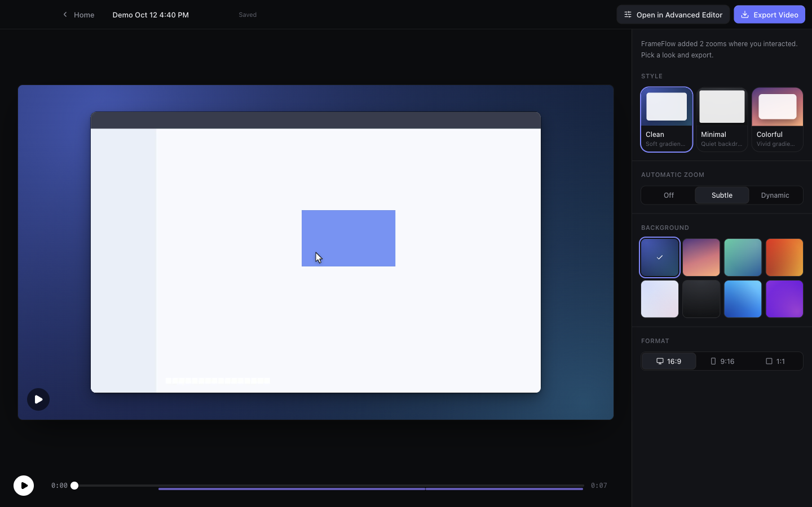 |  |
| Editing a zoom / Moment | 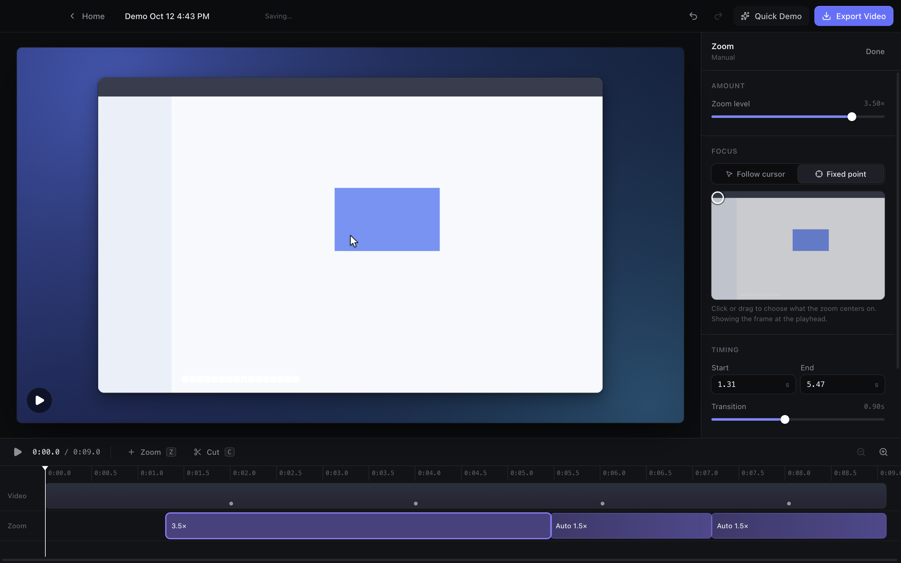 | 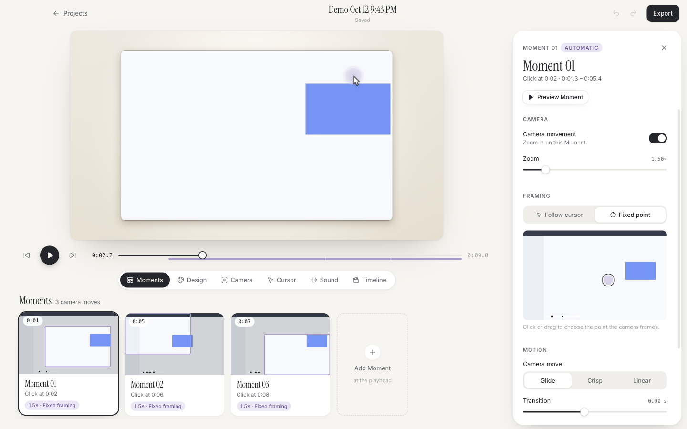 |
| Advanced editing |  |  |
| Export | 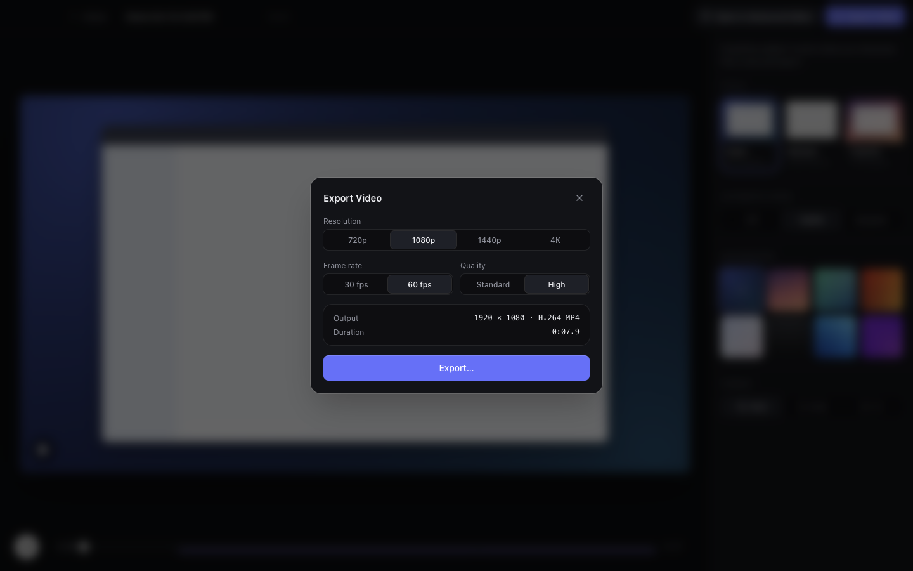 |  |
| Settings | 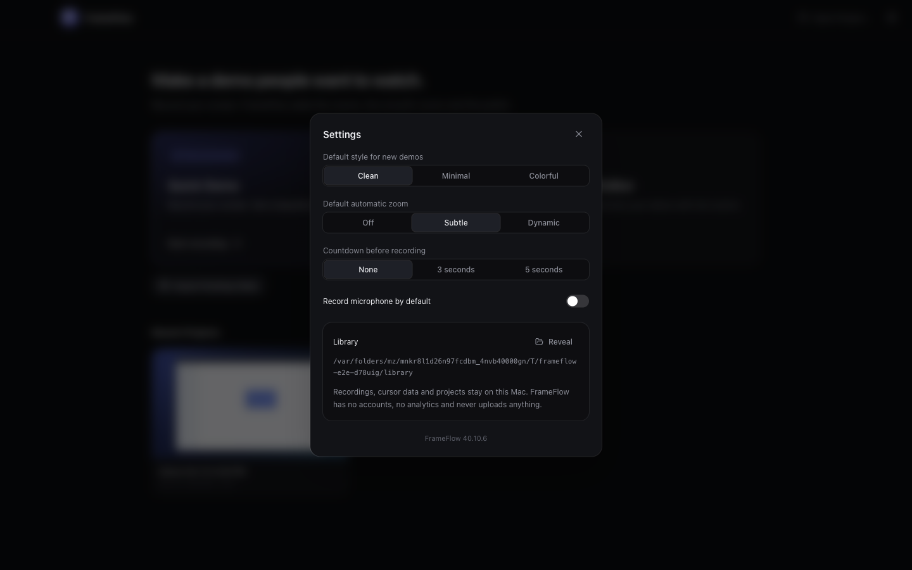 | 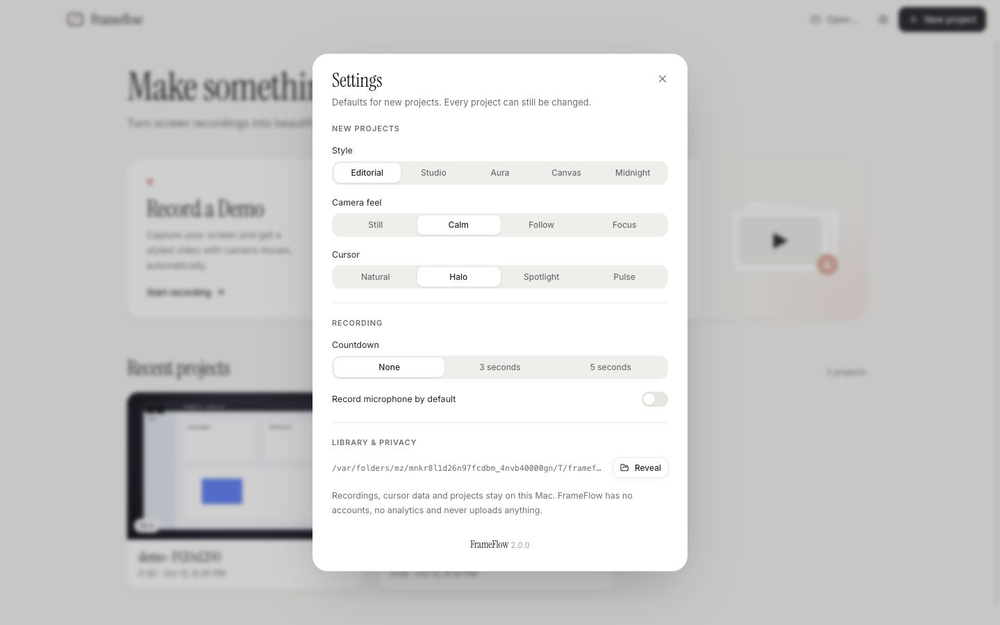 |

## What changed structurally (not just colour)

- **Navigation.** 0.1 had two separate screens, Quick Demo and Advanced Editor, each with
  its own layout. 2.0 has one **Studio** screen with a five-section dock. The preview stays
  mounted, so switching sections never reloads the video.
- **Hierarchy.** In 0.1 a settings sidebar was always visible and the timeline took the
  bottom third. In 2.0 the composition is the hero. Panels open only on demand as a drawer
  and close back to Moments.
- **Editing model.** In 0.1 you edited zoom blocks on a timeline. In 2.0 you edit **Moment
  cards** that show real frames, honest labels and their framing. The timeline is now the
  precision tool.
- **Choices as art direction.** In 0.1 you picked Clean, Minimal or Colorful and adjusted
  sliders. In 2.0 you choose a style from five live-rendered previews, a camera feel, and a
  cursor personality.
- **Home.** 0.1 had a dashboard with a recents grid. 2.0 has an editorial headline, two
  creation cards, and a gallery with rename, reveal, remove and missing-media states.
- **Identity.** 0.1 was a dark UI with an indigo accent and a system font. 2.0 uses warm
  paper with ink and lavender/coral accents, Instrument Serif display type with Inter for the
  interface, and a new frame-and-motion-path mark.
